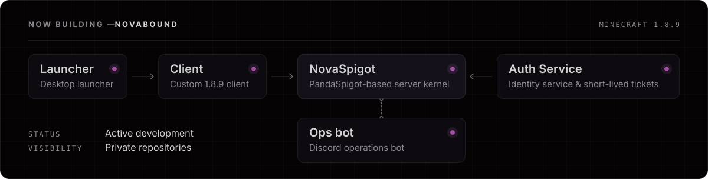
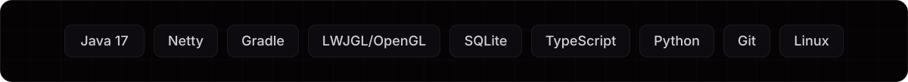
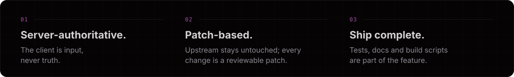

### About

I'm a Java developer working on Minecraft infrastructure: clients, servers and the services that connect them.

I build systems from the ground up and finish them: tested, documented and ready to ship.

### Now building

- [**Client & Launcher**](https://github.com/averagekar) — custom 1.8.9 client and its desktop launcher. *Private, in development.*
- [**NovaSpigot**](https://github.com/averagekar) — PandaSpigot-based server kernel, built as patches. *Private, in development.*
- [**Auth & Ops**](https://github.com/averagekar) — identity service with short-lived tickets, Discord ops bot. *Private, in development.*

### Selected work

| Project | What it is | Built with | Status |
| :-- | :-- | :-- | :-- |
| **NovaBound** | Minecraft 1.8.9 ecosystem | Java 17 · Netty · LWJGL | Private |
| **NovaSpigot** | PandaSpigot-based server kernel | Java · Netty · Gradle | Private |
| [**BlockArchitect**](https://github.com/averagekar/blockarchitect) | Parametric voxel CAD / Minecraft architecture engine | Python · Three.js | Public |

### Stack

### Principles

### Contact

